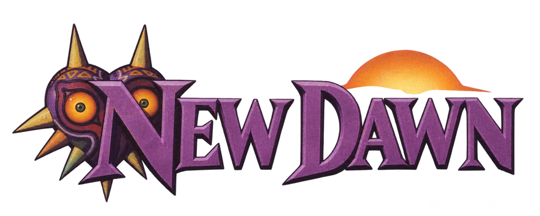

<p align="center"></p>

<p align="center"><b>A modern visual remaster of <i>The Legend of Zelda: Majora's Mask</i>, built on 2 Ship 2 Harkinian.</b></p>

**New Dawn** makes Termina look reborn, the way a current-generation remake would, while the game plays exactly
like the original. Gameplay, physics, timing, AI, schedules, cutscene sequencing and save data are untouched. Only
the rendering changes, and every effect can be switched off to get back the original code path.

New Dawn is a fork of [2 Ship 2 Harkinian](https://github.com/2ship2harkinian/2ship2harkinian) (2Ship), the PC port
of Majora's Mask, and of its renderer [libultraship](https://github.com/Kenix3/libultraship). See
[docs/NEW_DAWN.md](docs/NEW_DAWN.md) for the project's ground rules and layout, and
[ROADMAP.md](ROADMAP.md) for what's done and what's next.

> New Dawn includes no copyrighted game assets. You need your own supported copy of the game, exactly as with 2Ship.

## What New Dawn changes

Everything below is on in the **Ultra** look, which a fresh install starts with. Pick another look in **Esc → Graphics →
Quality** (Ultra, High, Medium, Low, or *Original look*); every feature also has its own toggle under *Graphics → Advanced*.

| Area | What you get |
|---|---|
| **Art direction** | A modern remake look in the spirit of the 2026 *Ocarina of Time* remake: a tactile, hyper-detailed world that is dark and beautiful, with colourful characters. New Dawn upgrades the original look rather than reproducing it. |
| **Textures** | About 2,300 world textures replaced with art-directed, practical-set materials (84 CC0 sets with regional variants), recoloured to Termina's palette and **generated on your machine from your own game** on first launch; unique painted art upscaled 4×. Relief and material response indoors and out. |
| **Lighting** | World-space global illumination (multi-bounce, stable, no light leaks); real-time sun shadows with cascades, culled-geometry casters and soft shadows from the nearest flames; warm flame light pools; darker, moodier nights and interiors; glowing clock and signs. |
| **Characters** | Smooth, rounded character geometry at render time (animations untouched), soft character shading and shiny metal. Optional: models converted from your own *Majora's Mask 3D* dump, with blinking and talking faces. |
| **Colour** | A linear HDR pipeline with a hue-preserving tonemap, deep darks and an art-directed grade per area and time of day. |
| **Sky** | A physical sky with volumetric clouds following the in-game clock; warm dawns and dusks; a real star field, Milky Way and Moon glow at night; special skies for the final day, cursed Ikana and the poisoned swamp, also in cutscenes. |
| **Water** | Rolling ocean swells, ripples and wakes around Link, flowing rivers, natural shoreline foam, reflections, refraction, caustics and an underwater view, with natural per-area colours. |
| **Vegetation and atmosphere** | Dense 3D grass that bends around Link, flowers and clover, light through leaves, volumetric fog, sun rays, dust, pollen, fireflies, rain, snow and wet ground, all moved by a shared wind. |
| **Effects** | Redrawn fire, embers, glows, sparks, explosions, magic arrows, a restyled sword trail, sparkles, frost and mask flashes. |
| **Image quality and options** | Temporal anti-aliasing plus MSAA; five looks (Ultra to Original) with measured costs; a performance overlay (F3); Mouse Look; a Warp tab and the Dev Tools. |

The renderer work is OpenGL-only for now. On Windows, choose OpenGL in *Display → Renderer API*.

## Getting started

### 1. Build
New Dawn has no prebuilt releases yet. Build it the same way as 2Ship; see [docs/BUILDING.md](docs/BUILDING.md).
On Linux:

```sh
git clone --recursive https://github.com/nyakuoff/New-Dawn.git
cd New-Dawn
cmake -S . -B build -G Ninja -DCMAKE_BUILD_TYPE=RelWithDebInfo
cmake --build build -j$(nproc)
cmake --build build --target Generate2ShipOtr
```

The game is `build/mm/2s2h.elf`. On first launch it asks for your ROM and extracts the game data, exactly like
2Ship. You can check that your dump is supported at <https://2ship.equipment/> or against
[docs/supportedHashes.json](docs/supportedHashes.json).

### 2. The New Dawn look
It is on by default. A fresh install starts with the **Ultra** look; an existing 2Ship config is left alone and you are
asked once whether to switch the look on. Press **Esc** and open **Graphics → Quality** to pick Ultra, High, Medium,
Low or *Original look* (every New Dawn effect off, the N64 path). The menu is described in [docs/MENU.md](docs/MENU.md).

### 3. Recommended: your *Majora's Mask 3D* dump
New Dawn can convert character models from your own *Majora's Mask 3D* (3DS) dump on your machine. In
**Graphics → Advanced → Experimental**, point the game at your decrypted RomFS folder and turn on **3DS character
models**. Nothing from the 3DS game is shipped with New Dawn.

Every New Dawn asset ships with the game (see [docs/licenses/THIRD_PARTY_ASSETS.md](docs/licenses/THIRD_PARTY_ASSETS.md)),
and everything derived from the original game (the remastered textures, upscaled art and converted models) is
generated on your machine, not downloaded. Community texture and model packs are not needed; they still load as
unofficial extras through 2Ship's **Use Alternate Assets** (**Tab**).

## Controls

These are 2Ship's defaults.

| N64 | A | B | Z | Start | Analog stick | C buttons | D-Pad |
| - | - | - | - | - | - | - | - |
| Keyboard | X | C | Z | Space | WASD | Arrow keys | TFGH |

| Keys | Action |
| - | - |
| Esc | Menu (looks and effects are under Graphics) |
| F1 | Toggle the menu bar |
| F11 | Fullscreen |
| Tab | Toggle alternate assets |
| Ctrl+R | Reset |

## Documentation

| Document | Contents |
|---|---|
| [ROADMAP.md](ROADMAP.md) | Finished, current and planned work |
| [docs/NEW_DAWN.md](docs/NEW_DAWN.md) | Ground rules, repository layout, workflow |
| [docs/MENU.md](docs/MENU.md) | The menu: pages, the five looks and their settings, first-run and migration |
| [docs/STATE.md](docs/STATE.md) | Feature status, the settings behind each feature and how it was verified |
| [docs/ARCHITECTURE.md](docs/ARCHITECTURE.md) · [docs/DECISIONS.md](docs/DECISIONS.md) | How the renderer is extended, and why |
| [docs/VALIDATION.md](docs/VALIDATION.md) | How visual changes are tested |
| Feature notes | One file per feature in [docs/](docs/), e.g. [PHYSICAL_SKY](docs/PHYSICAL_SKY.md), [CASCADED_SHADOWS](docs/CASCADED_SHADOWS.md), [LOCAL_LIGHTS](docs/LOCAL_LIGHTS.md), [WATER_FOAM](docs/WATER_FOAM.md), [VFX](docs/VFX.md) |
| [tools/newdawn/](tools/newdawn/README.md) | Capture and comparison tooling, material and recolour generators |

## Contributing

`main` always builds. Work goes on `feature/*` or `fix/*` branches and lands through pull requests. A renderer
change is two pull requests: one into `new-dawn` on
[New-Dawn-libultraship](https://github.com/nyakuoff/New-Dawn-libultraship), merged first, then one here that
moves the submodule pointer. Visual changes need before/after captures, and switching a feature off must give
output identical to `main`. Details are in [docs/NEW_DAWN.md](docs/NEW_DAWN.md) and
[docs/VALIDATION.md](docs/VALIDATION.md).

## Credits and license

New Dawn stands on [2 Ship 2 Harkinian](https://github.com/2ship2harkinian/2ship2harkinian) by HarbourMasters and
its contributors ([Discord](https://discord.com/invite/sxrPyuh697)), the
[Majora's Mask decompilation](https://github.com/zeldaret/mm), and
[libultraship](https://github.com/Kenix3/libultraship). Please direct New Dawn issues to this repository, not to
2Ship. The menu's fonts and art are listed in
[docs/licenses/MENU_ASSETS.md](docs/licenses/MENU_ASSETS.md) (Cinzel and Montserrat, SIL OFL 1.1). The effect, sky and
ground art that ships with the game is listed in
[docs/licenses/THIRD_PARTY_ASSETS.md](docs/licenses/THIRD_PARTY_ASSETS.md) and each pack's `MANIFEST.md` under
`mm/assets/newdawn/`:

- Stars: [HYG Database](https://github.com/astronexus/HYG-Database) by David Nash, CC BY-SA 4.0.
- Milky Way: NASA/Goddard Space Flight Center Scientific Visualization Studio
  ([Deep Star Maps 2020](https://svs.gsfc.nasa.gov/4851)); Gaia DR2: ESA/Gaia/DPAC, CC BY-SA 3.0 IGO.
- Lens flares: [Lens-Flares and Particles](https://opengameart.org/content/lens-flares-and-particles) by hackcraft.de,
  CC-BY 3.0.
- Particle sprites: [Particle Pack](https://kenney.nl/assets/particle-pack) by Kenney, CC0. Leaf:
  [Leaf Pack](https://opengameart.org/content/leaf-pack) by cemkalyoncu, CC0.
- Water caustics, grass tufts and the torch-fire flipbook are generated by scripts in `tools/newdawn/`, CC0.
- 3DS character texture upscaler: [PBRify_Remix](https://github.com/Kim2091/PBRify_Remix) UpscalerSPANV4, CC0.

The code is released under [CC0 1.0](LICENSE), the same as 2Ship. *The Legend of Zelda: Majora's Mask* is © Nintendo;
New Dawn is not affiliated with or endorsed by Nintendo. We do not condone piracy.

<a href="https://github.com/Kenix3/libultraship/">
  <picture>
    <source media="(prefers-color-scheme: dark)" srcset="./docs/poweredbylus.darkmode.png">
    
  </picture>
</a>
